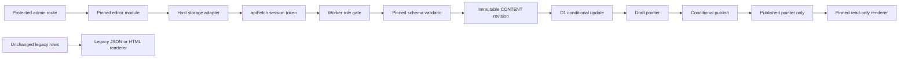

# Separate-repository editor integration

## Current rollout gate

The deployment repository remains independent of the editor repository. The
existing Tiptap editors are retained until the real pinned editor artifact,
replacement-node parity, and mounted-browser acceptance checks all pass.
The immutable storage layer and read-only legacy compatibility renderer do not
authorize production migration, deployment, settings, or credential changes.

**Artifact import, authenticated mounting, and full browser acceptance are not
complete yet.** Do not enable the new editing/public-rendering flags until the
artifact compatibility row below is populated and verified.

| Deployment baseline | Editor artifact | Status |
| --- | --- | --- |
| `404cd240e1b2c5e62d34d212c3589394321cfac6` | Not imported | Storage and compatibility preparation only |

## Data flow



The existing numeric D1 page/post IDs are content identities. Slugs are routing
metadata, not R2 keys. Content keys are
`page/<id>/revisions/<uuid>.json` and `post/<id>/revisions/<uuid>.json`.
`document_content` contains separate draft/published keys, UUID revision tokens,
R2 ETags, and schema version. The separate pointer table avoids leaking private
draft keys through the existing public `SELECT *` record queries.

No existing body, template content, row, bucket, or database is rewritten.
Records with legacy body/template content cannot be enrolled implicitly. Saving
a new immutable revision writes R2 first and then performs one D1 CAS.
Failed/concurrent writes may leave an unreferenced R2 object; no public reader
can discover it. Publishing uses a transactional D1 batch to CAS both expected
draft and published tokens and activate public visibility together.

## Flags and authentication

`CONTENT_API_ENABLED=true` opts into the new pointer-aware Worker behavior.
`PUBLIC_JSON_ENABLED=true` additionally enables public structured reads.
Neither is enabled by this change in the production configuration. New admin
routes must remain under the existing `RequireAuth` boundary.

The host adapter uses `src/lib/auth.ts`'s `apiFetch`; the stored session token is
attached as the existing Authorization header. The editor must not read token
storage, implement another login/setup page, or rely on cookies. Editors retain
the existing create/edit permission and cannot DELETE. Admin user-management
restrictions remain unchanged.

Disabling public JSON rendering when structured pointers exist produces an
explicit unavailable response, not legacy fallback or the latest draft.
Disabling an editor UI does not make an R2-backed record safe to open in the old
editor. Legacy PUT writes and publication toggles for such IDs are rejected,
including concurrent enrollment races. Unpublish/trash toggles remain permitted.

## API contract

The host-owned API accepts a validated editor document; its shape and schema
version come from the actual pinned DOM-free validator, not a parallel schema.

| Endpoint | Behavior |
| --- | --- |
| `GET /api/admin/{pages,posts}/:id/content` | Latest draft plus `revision`, `publishedRevision`, and `format` |
| `PUT /api/admin/{pages,posts}/:id/content` | `{document, expectedRevision}`; null is create-only |
| `POST /api/admin/{pages,posts}/:id/publish` | `{expectedRevision, expectedPublishedRevision}`; both required |
| `PATCH /api/admin/{pages,posts}/:id/metadata` | Slug, excerpt, cover image with `expectedRevision`; no legacy body writes or published toggle |

Bodies are bounded to **1 MiB UTF-8 JSON**, including chunked requests. Unsupported
schema/identity/URLs/attributes must fail validation. Failures are explicit:
400 invalid input, 401 missing/expired session, 403 role restriction, 404 missing
record/unpublished structured document, 409 revision conflict, 413 too large,
415 wrong media type, and 503 missing/corrupt/unavailable storage.

Do not retry a 409 as last-write-wins. Keep unsaved work and offer explicit reload
or export. Network/401 failures must not clear the editor document. Broken R2
references must not fall back to D1 content. Fallback is only for a record with
no structured pointers.

## Local-only existing-site upgrade verification

Run these from this isolated checkout; never add `--remote` to a test command.
Use the existing `DB`, `CONTENT`, and `media` bindings. Do not provision replacement
resources or repeat initial-account setup on the deployed site.

Historical pristine migration replay currently fails: `0001_init.sql` indexes
the absent `published_date` column, and the migration set does not create the
`pages` table expected by `0008_sample_pages.sql`. The integration intentionally
does not repair or replay those migrations. The fixture below simulates the
queried schema of an **already-existing site**, not a clean-install proof.

```powershell
pnpm build
pnpm exec wrangler d1 execute paulibaby-blog --local --persist-to .wrangler\editor-integration --file tests\fixtures\existing-site.sql
pnpm exec wrangler d1 execute paulibaby-blog --local --persist-to .wrangler\editor-integration --file scripts\content-preflight.sql
pnpm exec wrangler d1 execute paulibaby-blog --local --persist-to .wrangler\editor-integration --file migrations\0011_document_revisions.sql
node --test tests\revisionStore.test.mjs tests\legacyRenderer.test.mjs
pnpm exec tsc --noEmit -p tsconfig.editor-integration.json
pnpm exec eslint src\content src\editor\Prose.tsx tests\revision-runtime.ts
pnpm exec wrangler dev tests\revision-runtime.ts --config wrangler.jsonc --local --persist-to .wrangler\editor-integration --assets dist\client --port 8794 --inspector-port 9294 --show-interactive-dev-session=false
```

Run the fixture once in a new local persistence directory. Against an existing
local database, start with preflight instead; never erase or reload its records.
In another terminal:

```powershell
Invoke-RestMethod http://127.0.0.1:8794/api/revision-check | ConvertTo-Json -Depth 5
```

The dedicated test entry is not imported by the application. It uses local real
D1/R2 bindings to verify racing saves, transactional publish, draft isolation,
legacy-write protection, stored-session auth, editor deletion restrictions, slug
rename, and missing referenced R2 failure. Stop that specific test process after
checking the result.

The production build uses Cloudflare Vite: static client assets land in
`dist\client`, and the generated Worker configuration lands in `dist\paulibaby`.
Do not replace the host `index.html` with the editor's standalone Pages app.

## Tiptap compatibility and removal gate

| Active surface | Attributes/behavior | Legacy compatibility | Removal gate |
| --- | --- | --- | --- |
| Paragraph/headings h1-h3 | `textAlign`, heading `level` | Semantic HTML, safe alignment | New accessible text controls and round trips |
| Bold/italic/strike/underline/code/link | Link href/target/rel/class; autolink/paste | Escaped marks, safe URL validation | Editing/paste/keyboard parity |
| Bullet/ordered lists/items | Ordered `start`/`type`, all nested items | Preserved lists and item content | Lossless multi-item transformations |
| Blockquote/hard break/divider | Nested text and marks | Semantic elements | Insertion/transform behavior |
| Code block | `language`, lowlight editor behavior | Code text/language preserved | Syntax controls/highlighting parity |
| Callout | `variant`: info/warning/success | Data attributes and styled content | Variant controls/round trips |
| Columns/column | Count two/three, column width | Nested layouts and width | Insertion/reorder/accessibility |
| Accordion/header/content | Header text only; nested blocks | Native details/summary | Keyboard operation and nesting |
| Image/resize/upload | src/alt/title/width/height/containerStyle/wrapperStyle | Constrained styles and metadata | Resize, media, upload/paste/drop parity |
| Audio/video | src; forced controls | Native media controls | Source editing/upload metadata |
| YouTube | `videoId` | Provider URL and titled/sandboxed iframe | Validated insertion/dialog |
| Vimeo | src/width/height; configured controls/keyboard/transcript | Provider URL and titled/sandboxed iframe | Fix current missing BlockEditor registration |
| Generic iframe | src/width/height | HTTPS, explicit title/restricted sandbox | Source/title/permissions controls |
| Interaction | Undo/redo, placeholder, focus, toolbar, reorder/duplicate/delete | Not a public-rendering concern | Mounted browser and keyboard acceptance |

`tests\fixtures\legacy-all-nodes.json` covers every active node/mark and custom
attribute, including nested layouts/embeds and two-item lists. Rendering is
read-only; unknown nodes/marks/attributes produce visible diagnostics, never
empty output or data conversion. Unsafe legacy embeds/URLs/styles are refused
explicitly rather than copied into public HTML.

Installed search-and-replace has no source imports. The alternate
`ColumnExtension` and `CalloutExtension` are unused. The legacy extension registry
duplicates Video/Iframe/Callout and disables codeBlock, unlike BlockEditor; the
replacement must preserve supported behavior, not these duplications.

**Tiptap removal is still gated.** Do not delete the old editor, toolbar/focus/
upload extensions, package dependencies, or Vite vendor split until the actual
artifact passes node/attribute/interaction parity, legacy fixtures, host mounting,
public rendering, media, keyboard, and accessibility acceptance.

## Reversible deployment sequence (manual approval required)

1. Back up existing D1 metadata and record the previous deployed artifact/pin.
2. Run the schema preflight against the intended existing site before applying
   `0011`; missing queried tables/columns must stop the upgrade.
3. Apply only the additive migration using the site's established migration
   process. Do not backfill bodies, import content, or drop columns.
4. Deploy the API with the new UI disabled, retaining legacy editing and content.
5. Import the verified pinned editor/renderer/schema artifact; enable editing only
   for new structured documents under the protected routes.
6. Validate local/staged page/post round trips, auth expiry, conflict recovery,
   media, direct URL refresh, draft isolation and publish before public activation.
7. Enable pinned JSON public rendering; retire Tiptap only after the parity gate.

Rollback keeps all D1 metadata/pointers and R2 revisions. During transition,
disable new editing and restore the previous pin while keeping R2 public reads
functional. After removal, restore the entire prior deployment artifact rather
than deleting content or reversing the additive migration. Track R2-only
published documents: an old artifact without R2 rendering cannot serve them and
must not silently make them disappear.

Unreferenced revision cleanup is a separate reviewed operation. Compare every
candidate key against **both** pointer columns, take a retention window, and
recheck immediately before deleting a specific object. Never bulk-delete a
prefix, rewrite an immutable revision, or delete a bucket/database for rollback.
