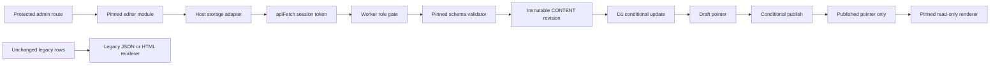

# Separate-repository editor integration

## Current rollout gate

The deployment repository remains independent of the editor repository. The
existing Tiptap editors are retained until the real pinned editor artifact,
replacement-node parity, and mounted-browser acceptance checks all pass.
The immutable storage layer and read-only legacy compatibility renderer do not
authorize production migration, deployment, settings, or credential changes.

**A clean committed artifact is pinned; full browser/parity acceptance is not
complete.** The editor repository reports production `NODE_ENV` substitution and
a narrow public-renderer graph fixing the previously observed artifact blockers.
The host imported all 12 checksum/size-verified assets without running app tests
after the user-directed stop. Host loaders use the final manifest's shared
`PageDocumentRenderer.css` and an absolute same-origin media base.

| Deployment baseline | Editor artifact | Status |
| --- | --- | --- |
| `404cd240e1b2c5e62d34d212c3589394321cfac6` | `55ae05d447f505fc20433da22fe85df9a2638799` (clean) | Imported; rollout disabled pending acceptance |

Outstanding editor follow-ups are full new-control keyboard/axe acceptance,
semantic rich-text validation wiring, and initial-load autosave behavior. See
the editor repository's `docs/editor-parity-matrix.md` at the pinned revision.
Host save/publish/media/dirty-navigation and public browser acceptance against
this final artifact remain unverified. These gaps prohibit enabling the new
rollout flags or removing Tiptap.

## Data flow



The existing numeric D1 page/post IDs are content identities. Slugs are routing
metadata, not R2 keys. Content keys are
`page/<id>/revisions/<uuid>.json` and `post/<id>/revisions/<uuid>.json`.
`document_content` contains separate draft/published keys, UUID revision tokens,
R2 ETags, and schema version. The separate pointer table avoids leaking private
draft keys through the existing public `SELECT *` record queries.

No existing body, template content, row, bucket, or database is rewritten.
Records with legacy body/template content cannot be enrolled implicitly. Saving
a new immutable revision writes R2 first and then performs one D1 CAS.
Failed/concurrent writes may leave an unreferenced R2 object; no public reader
can discover it. Publishing uses a transactional D1 batch to CAS both expected
draft and published tokens and activate public visibility together.

## Flags and authentication

`CONTENT_API_ENABLED=true` enables the new save/publish/metadata endpoints.
`PUBLIC_JSON_ENABLED=true` enables public structured reads.
`EDITOR_UI_ENABLED=true` together with the content flag enables authenticated
`/admin/editor` and `/admin/editor/{pages,posts}/:id` mounting.
None are enabled in the production configuration. Existing structured-pointer
write/publication protections stay active even when rollout flags are disabled;
sites without the additive table retain their legacy behavior.

The host adapter uses `src/lib/auth.ts`'s `apiFetch`; the stored session token is
attached as the existing Authorization header. The editor must not read token
storage, implement another login/setup page, or rely on cookies. Editors retain
the existing create/edit permission and cannot DELETE. Admin user-management
restrictions remain unchanged.

Media listing/upload reuse `/api/admin/media` and preserve the existing R2 key,
alt text, title, caption, and dimensions. The host media adapter returns
same-origin `/api/media/<encoded-key>` URLs so local R2 previews never fetch
production uploads. This read-only streaming endpoint supports HEAD and byte
ranges for audio/video; executable/unsupported file types are downloads with
`nosniff`, not inline HTML. The existing media domain remains unchanged.

Disabling public JSON rendering when structured pointers exist produces an
explicit unavailable response, not legacy fallback or the latest draft.
Disabling an editor UI does not make an R2-backed record safe to open in the old
editor. Legacy PUT writes and publication toggles for such IDs are rejected,
including concurrent enrollment races. Unpublish/trash toggles remain permitted.

## API contract

The host-owned API accepts a validated editor document; its shape and schema
version come from the actual pinned DOM-free validator, not a parallel schema.

| Endpoint | Behavior |
| --- | --- |
| `GET /api/admin/{pages,posts}/:id/content` | Latest draft plus `revision`, `publishedRevision`, and `format` |
| `PUT /api/admin/{pages,posts}/:id/content` | `{document, expectedRevision}`; null is create-only |
| `POST /api/admin/{pages,posts}/:id/publish` | `{expectedRevision, expectedPublishedRevision}`; both required |
| `PATCH /api/admin/{pages,posts}/:id/metadata` | Slug, excerpt, cover image with `expectedRevision`; no legacy body writes or published toggle |
| `GET/POST /api/admin/editor/{pages,posts}` | Host-owned metadata list/new numeric identity; new records start unpublished and empty |

The adapter follows the editor's actual PageStore contract: `load` returns
`{document, revision, publishedRevision}`, not a document with revision fields.
Remote calls require `{kind, id}`; standalone LocalStore string identities are
rejected by the remote adapter. Null save tokens are create-only; omitted tokens
are never treated as unconditional remote writes.

## Importing a real pinned artifact

The editor build must supply a clean committed source revision and
`dist-embed\manifest.json` containing format, artifactVersion, sourceRevision,
sourceDirty=false, schemaVersion, and SHA-256/size for every asset. Required
exports are `editor.js`, `schema.js`, `renderer.js` and their declarations. The
Worker imports only the DOM-free schema entry; public routes import only the
read-only renderer with its own isolated React root.

```powershell
pnpm editor:import <verified-artifact-folder> <full-source-commit>
pnpm build
```

Import verifies every manifest entry, disallows symlinks/traversal, refuses dirty
builds and checksum/size mismatches, and stores immutable source assets under
`vendor\editor\<commit>`. `editor-artifact.json` pins the source and manifest hash.
The build re-verifies the pin and stages assets under
`public\editor-assets\<commit>` before Vite copies them into `dist\client`.
Generated public copies are ignored by Git; the verified vendor artifact and
pin are committed, so no hidden cross-repository checkout is needed to build.
No synthetic verification-test assets are ever imported as an editor.

A coordinator-supplied dirty artifact may be imported with `import-local` only
when `EDITOR_ALLOW_DIRTY=true` is explicitly set in that shell. The resulting
development pin refuses a normal release build. Replace it with a clean
committed artifact before release; never patch checksummed vendor files or add
browser shims to conceal artifact failures.

Bodies are bounded to **1 MiB UTF-8 JSON**, including chunked requests. Unsupported
schema/identity/URLs/attributes must fail validation. Failures are explicit:
400 invalid input, 401 missing/expired session, 403 role restriction, 404 missing
record/unpublished structured document, 409 revision conflict, 413 too large,
415 wrong media type, and 503 missing/corrupt/unavailable storage.

Do not retry a 409 as last-write-wins. Keep unsaved work and offer explicit reload
or export. Network/401 failures must not clear the editor document. Broken R2
references must not fall back to D1 content. Fallback is only for a record with
no structured pointers.

## Local-only existing-site upgrade verification

**Verification is paused by user direction.** Do not run the app, authenticated
requests, browser acceptance, or the local runtime/test commands below until
the user explicitly authorizes testing again. These commands document the
previous local procedure, not authorization to execute it. Full mounted-browser
and replacement-node acceptance remains incomplete; retain Tiptap and leave
production rollout flags disabled.

Run these from this isolated checkout; never add `--remote` to a test command.
Use the existing `DB`, `CONTENT`, and `media` bindings. Do not provision replacement
resources or repeat initial-account setup on the deployed site.

Historical pristine migration replay currently fails: `0001_init.sql` indexes
the absent `published_date` column, and the migration set does not create the
`pages` table expected by `0008_sample_pages.sql`. The integration intentionally
does not repair or replay those migrations. The fixture below simulates the
queried schema of an **already-existing site**, not a clean-install proof.

```powershell
pnpm build
pnpm exec wrangler d1 execute paulibaby-blog --local --persist-to .wrangler\editor-integration --file tests\fixtures\existing-site.sql
pnpm exec wrangler d1 execute paulibaby-blog --local --persist-to .wrangler\editor-integration --file scripts\content-preflight.sql
pnpm exec wrangler d1 execute paulibaby-blog --local --persist-to .wrangler\editor-integration --file migrations\0011_document_revisions.sql
pnpm exec wrangler d1 execute paulibaby-blog --local --persist-to .wrangler\editor-integration --file migrations\0009_media.sql
node --test tests\revisionStore.test.mjs tests\legacyRenderer.test.mjs
pnpm exec tsc --noEmit -p tsconfig.editor-integration.json
pnpm exec eslint src\content src\editor\Prose.tsx tests\revision-runtime.ts
pnpm exec wrangler dev tests\revision-runtime.ts --config wrangler.jsonc --local --persist-to .wrangler\editor-integration --assets dist\client --port 8794 --inspector-port 9294 --show-interactive-dev-session=false
```

Run the fixture once in a new local persistence directory. Against an existing
local database, start with preflight instead; never erase or reload its records.
In another terminal:

```powershell
Invoke-RestMethod http://127.0.0.1:8794/api/revision-check | ConvertTo-Json -Depth 5
```

The dedicated test entry is not imported by the application. It uses local real
D1/R2 bindings to verify racing saves, transactional publish, draft isolation,
legacy-write protection, stored-session auth, editor deletion restrictions, slug
rename, and missing referenced R2 failure. Stop that specific test process after
checking the result.

The existing media migration is applied above only when the isolated fixture
lacks that table; never replay it against an existing site that already has it.
The runtime harness also exercises real schema validation, both numeric content
kinds, create-only conflicts, publish-followed-by-draft-save, flag-disabled
legacy bypass rejection, corrupt references, upload/list/alt updates and
same-origin media reads.

For local browser acceptance, seed `tests\fixtures\browser-session.sql` into
that **local-only** database, then run the actual host Worker:

```powershell
pnpm exec wrangler d1 execute paulibaby-blog --local --persist-to .wrangler\editor-integration --file tests\fixtures\browser-session.sql
pnpm exec wrangler dev src\worker.ts --config wrangler.jsonc --local --persist-to .wrangler\editor-integration --assets dist\client --port 8795 --inspector-port 9295 --var CONTENT_API_ENABLED:true --var PUBLIC_JSON_ENABLED:true --var EDITOR_UI_ENABLED:true --show-interactive-dev-session=false
```

At `http://127.0.0.1:8795`, set the fixture value
`local-integration-browser-session` under the host's
`paulibaby_admin_token` local-storage key. It is a deterministic local fixture,
not a deployed credential or login-password substitute. Verify native artifact
imports, save/conflict/publish, typed-route refresh, dirty anchor/back/forward
navigation, expired authorization, media and public rendering. The host uses
the router's blocker plus a discard dialog, and refresh uses `beforeunload`.
Stop the specific browser-check server when finished.

The production build uses Cloudflare Vite: static client assets land in
`dist\client`, and the generated Worker configuration lands in `dist\paulibaby`.
Do not replace the host `index.html` with the editor's standalone Pages app.

## Tiptap compatibility and removal gate

### Production bundle regression

The retained Tiptap vendor group includes `@tiptap`, `prosemirror-*`, lowlight
and highlight.js without a `maxSize` subdivision. Size-based splitting created
a circular dependency between the state and transform/view chunks: ProseMirror's
`Transaction extends Transform` evaluated before `Transform` was initialized.
The original matcher also missed the actual `prosemirror-*` package names.
Keep this graph together while retaining the lazy editor vendor boundary.
Do not restore a size cap without proving module initialization remains safe.

`pnpm exec playwright install chromium` installs the browser needed by
`pnpm test:editor-bundle`. That command builds the real production assets and
imports each emitted editor vendor module in a fresh blank Chromium context.
It does not visit authenticated pages or call authenticated APIs. The check
reproduces the original initialization error before the bundling fix; it is
not evidence of editor-page mounting, editing or save acceptance.

| Active surface | Attributes/behavior | Legacy compatibility | Removal gate |
| --- | --- | --- | --- |
| Paragraph/headings h1-h3 | `textAlign`, heading `level` | Semantic HTML, safe alignment | New accessible text controls and round trips |
| Bold/italic/strike/underline/code/link | Link href/target/rel/class; autolink/paste | Escaped marks, safe URL validation | Editing/paste/keyboard parity |
| Bullet/ordered lists/items | Ordered `start`/`type`, all nested items | Preserved lists and item content | Lossless multi-item transformations |
| Blockquote/hard break/divider | Nested text and marks | Semantic elements | Insertion/transform behavior |
| Code block | `language`, lowlight editor behavior | Code text/language preserved | Syntax controls/highlighting parity |
| Callout | `variant`: info/warning/success | Data attributes and styled content | Variant controls/round trips |
| Columns/column | Count two/three, column width | Nested layouts and width | Insertion/reorder/accessibility |
| Accordion/header/content | Header text only; nested blocks | Native details/summary | Keyboard operation and nesting |
| Image/resize/upload | src/alt/title/width/height/containerStyle/wrapperStyle | Constrained styles and metadata | Resize, media, upload/paste/drop parity |
| Audio/video | src; forced controls | Native media controls | Source editing/upload metadata |
| YouTube | `videoId` | Provider URL and titled/sandboxed iframe | Validated insertion/dialog |
| Vimeo | src/width/height; configured controls/keyboard/transcript | Provider URL and titled/sandboxed iframe | Fix current missing BlockEditor registration |
| Generic iframe | src/width/height | HTTPS, explicit title/restricted sandbox | Source/title/permissions controls |
| Interaction | Undo/redo, placeholder, focus, toolbar, reorder/duplicate/delete | Not a public-rendering concern | Mounted browser and keyboard acceptance |

`tests\fixtures\legacy-all-nodes.json` covers every active node/mark and custom
attribute, including nested layouts/embeds and two-item lists. Rendering is
read-only; unknown nodes/marks/attributes produce visible diagnostics, never
empty output or data conversion. Unsafe legacy embeds/URLs/styles are refused
explicitly rather than copied into public HTML.

Installed search-and-replace has no source imports. The alternate
`ColumnExtension` and `CalloutExtension` are unused. The legacy extension registry
duplicates Video/Iframe/Callout and disables codeBlock, unlike BlockEditor; the
replacement must preserve supported behavior, not these duplications.

**Tiptap removal is still gated.** Do not delete the old editor, toolbar/focus/
upload extensions, package dependencies, or Vite vendor split until the actual
artifact passes node/attribute/interaction parity, legacy fixtures, host mounting,
public rendering, media, keyboard, and accessibility acceptance.

## Reversible deployment sequence (manual approval required)

1. Back up existing D1 metadata and record the previous deployed artifact/pin.
2. Run the schema preflight against the intended existing site before applying
   `0011`; missing queried tables/columns must stop the upgrade.
3. Apply only the additive migration using the site's established migration
   process. Do not backfill bodies, import content, or drop columns.
4. Deploy the API with the new UI disabled, retaining legacy editing and content.
5. Import the verified pinned editor/renderer/schema artifact; enable editing only
   for new structured documents under the protected routes.
6. Validate local/staged page/post round trips, auth expiry, conflict recovery,
   media, direct URL refresh, draft isolation and publish before public activation.
7. Enable pinned JSON public rendering; retire Tiptap only after the parity gate.

Rollback keeps all D1 metadata/pointers and R2 revisions. During transition,
disable new editing and restore the previous pin while keeping R2 public reads
functional. After removal, restore the entire prior deployment artifact rather
than deleting content or reversing the additive migration. Track R2-only
published documents: an old artifact without R2 rendering cannot serve them and
must not silently make them disappear.

Unreferenced revision cleanup is a separate reviewed operation. Compare every
candidate key against **both** pointer columns, take a retention window, and
recheck immediately before deleting a specific object. Never bulk-delete a
prefix, rewrite an immutable revision, or delete a bucket/database for rollback.
